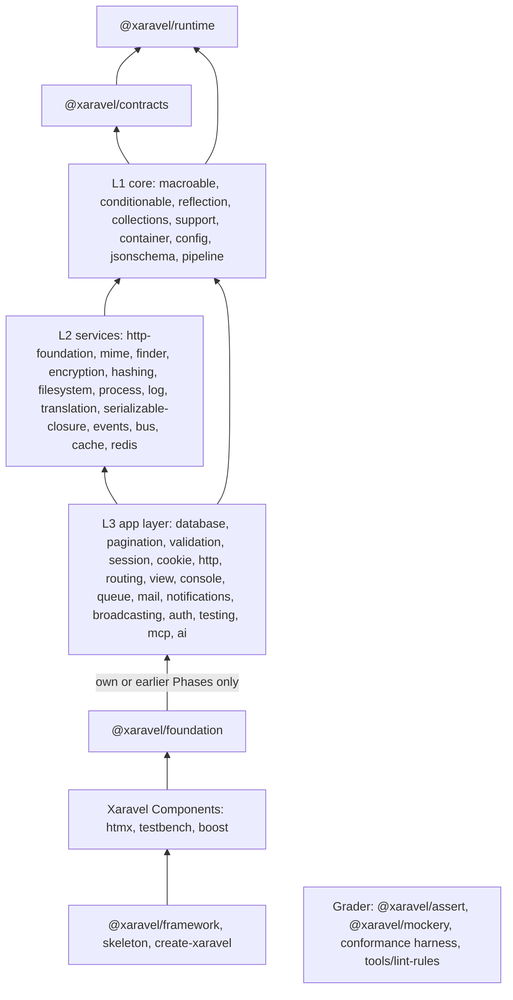
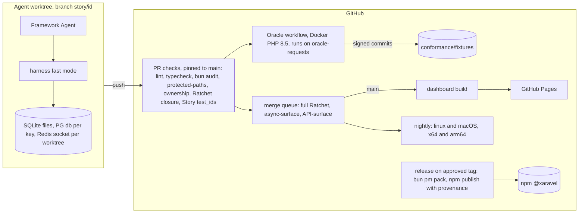

# Architecture Spine — Xaravel

Priority order for every call below, and for every call this spine leaves open: **(1) the Laravel App Developer experience (PRD §5.1 parity rule), (2) unattended parallel Framework Agent throughput.**

Every AD is binding. `[ADOPTED]` marks the ones the Maintainer chose explicitly.

## Design Paradigm

**Ported Laravel.** Xaravel keeps Laravel's architecture rather than inventing one:
- an IoC container booted by service providers (`register`, then `boot`);
- facades and helpers as static entry points into the container;
- a **Contract → Manager → Driver** adapter at every IO boundary.

**Sync core, async edges (DIV-1).** IO happens only behind the async-root Driver contracts (AD-6). Everything else is synchronous.

**Async-aware sandbox (DIV-11).** An Application boots once and is shared by every unit of work it serves: one per process in production, one per test in tests. Each unit (request, job, command, scheduled task, test, WebSocket message) runs in a **Scope Frame**. A Scope Frame is Octane's per-request sandbox, located through `AsyncLocalStorage` because Bun interleaves units at every `await`.

| Layer | Lives in | May depend on |
| --- | --- | --- |
| Runtime primitives (scope, registry, PHP values, codecs) | `packages/runtime` | nothing |
| Contracts (interfaces, tokens, brands, alias table) | `packages/contracts` | runtime |
| Ported Upstream Components | `packages/<component>` | runtime, contracts, its Upstream `require` list |
| Foundation (lifecycle, kernels, providers, generators) | `packages/foundation` | Components of its own or earlier Phases (AD-2) |
| Xaravel Components (htmx, testbench, boost) | `packages/<name>` | Upstream Components and Foundation |
| Grader (matchers, mockery, harness, lint rules) | `packages/assert`, `packages/mockery`, `conformance/`, `tools/` | nothing graded |
| Distribution (meta-package, Skeleton, Installer) | `packages/framework`, `skeleton/`, `installer/` | everything above |

## Invariants & Rules

### Dependency direction



Arrows point from a dependent to its dependency. Every package may also depend directly on `runtime` and `contracts`. The grader has no edges to graded packages. The tiers are a guide; the per-package edge list in AD-2 is authoritative.

### AD-1 — `@xaravel/contracts`: tokens, brands, aliases [ADOPTED]

- **Binds:** all Components; FR-10, FR-19, FR-21, DIV-1, DIV-3
- **Prevents:**
  - packages importing each other's half-built implementations to reach an interface;
  - two owners or two instances of one service;
  - duck-typed `instanceof` checks that disagree.
- **Rule:**
  - **Contents.** Every `Illuminate\Contracts\*` interface is ported into `@xaravel/contracts` at the subpath of its Upstream namespace (`Illuminate\Contracts\Mail\Mailer` → `@xaravel/contracts/mail`). Each contract exports an `interface` and a runtime **token** under the same name. The token's brand key is `Symbol.for('<Upstream FQCN>')`, so `@xaravel/runtime` and the grader can detect it without importing contracts. The interface requires `readonly [Token]: true`, and the token's `Symbol.hasInstance` reads that brand, so `x instanceof Arrayable` works as in PHP and `implements` forces the brand at compile time (brand placement: AD-9).
  - **Concrete types inside contracts.** Where an Upstream contract names a concrete class (`Request`, `Response`, `Collection`), the TS contract uses a structural interface declared in `@xaravel/contracts`. It never imports the implementation.
  - **Container keys.** Framework code injects contracts by token. The container's public API accepts `string | token | class` abstracts exactly as Upstream does.
  - **Alias table.** `@xaravel/contracts/aliases` ports Upstream's `registerCoreContainerAliases` and each provider's string bindings verbatim, as data: alias string → FQCN string. The container resolves a class argument through `fqcn(class)` and then this table. Every service has one **canonical token**: the most specific contract it is aliased to (`CacheManager` → `Cache\Factory`). Providers bind only the canonical token. Concrete-class tokens, other contracts, the Upstream FQCN string and short aliases (`'cache'`) are aliases of it, so autowiring a listed concrete class never builds a second instance.
  - **App and package interfaces.** Their tokens are made with `contract<T>('<FQCN>')`. Abstract classes are tokens as-is. Importing a contract with `import type` for injection is a lint error.
  - **Phase and protection.** The package is completed in Phase 1, together with every Xaravel-only contract listed in AD-27. It is verified by Xaravel Tests plus the API-surface check (AD-15), and is Protected after Phase 1.

### AD-2 — Package edges mirror Upstream `composer.json`, acyclic

- **Binds:** FR-10, FR-11, FR-14, FR-109; every `package.json`
- **Prevents:** hidden coupling between parallel Epics; dependency cycles; packages that can't be installed standalone; Foundation reaching into packages from later Phases.
- **Rule:**
  - **Upstream edges.** For each Upstream Component, `illuminate/*` packages in `require` become `dependencies` (`workspace:*`). `illuminate/*` packages in `suggest` become optional `peerDependencies`, reachable only through a container token or alias or a guarded `import()`.
  - **Always allowed.** Any package may depend on `@xaravel/runtime` and `@xaravel/contracts`.
  - **Third-party code.** Third-party `require` entries follow AD-22.
  - **CI checks.** CI fails on a dependency cycle, and on a static import of a package not listed in `dependencies`. Each package is type-checked as its own `tsc` project reference with `types` limited to its dependencies.
  - **Foundation.** It statically imports only Components of its own or earlier Phases. Default providers, middleware priority and later Components are FQCN strings, resolved through the Class Registry, and a provider whose package isn't installed is skipped. A later package adds itself through package discovery, and never edits Foundation. Discovery works as in Laravel:
    - It reads `package.json` → `"xaravel": { "providers": [...], "aliases": {...}, "dontDiscover": [...] }`. `aliases` means Laravel's facade aliases, not container aliases.
    - `package:discover` caches the result to `bootstrap/cache/packages.json`.
    - Providers load in this order: framework defaults, then discovered providers, then `bootstrap/providers.ts`.
  - **Meta-package.** `@xaravel/framework` lists every optional peer as a real dependency.
  - **Grader.** Graded packages take the grader only as a `devDependency`. There are two exceptions: `@xaravel/testing` may depend on `@xaravel/mockery` at runtime (FR-100), and `@xaravel/support` takes it as an optional peer for `Facade.shouldReceive` / `spy` / `partialMock`.
  - **Tests.** Test files form their own `tsc` project. They may import grader packages and any package of the same or an earlier Phase, through `devDependencies`. Dev edges are excluded from the cycle check. A Test ID that needs a later-Phase package is `blocked-by:<that package>`.
  - **Scaffolding.** A Phase 0 Infrastructure Story scaffolds every package: `package.json`, a generated `tsconfig.json` that extends the Protected `tsconfig.base.json`, `src/`, `tests/`, and the root project references. Afterwards, Stories may edit their package's own `package.json`. CI checks that each package `tsconfig.json` equals its generated form.
  - **Boost framework mode.** It is the private workspace `tools/boost-framework`. Its only dependency is `@modelcontextprotocol/server`, and it reads `conformance/`, `stories/` and `decisions/` read-only.

### AD-3 — Public import paths mirror Upstream

- **Binds:** all public API; generators (FR-71); docs (NFR-9); FR-21
- **Prevents:** competing export layouts; one class exported from two packages; helpers with no home.
- **Rule:**
  - **Package subpaths follow the Upstream directory.** `src/Illuminate/Collections/Collection.php` → named export `Collection` from `@xaravel/collections`, file `src/Collection.ts`. One public class per file, keeping the Upstream class name.
  - **`@xaravel/framework/<namespace-kebab>` follows the PHP namespace.** `Illuminate\Support\Collection` → `@xaravel/framework/support`; `Illuminate\Support\Facades\Route` → `@xaravel/framework/support/facades`. Generated app code and docs always import from `@xaravel/framework/...`.
  - **Helpers.** Each component's `helpers.php` → `@xaravel/<component>/helpers`, re-exported flat from `@xaravel/framework/helpers`, which generators import. Blade templates, `tinker` and queued closures (AD-14) get the helpers and facades in scope automatically.
  - **Decorators and token factories.** They live beside what they configure: `inject` and the contextual-attribute descriptors → `@xaravel/framework/container`; relationship and `attribute` / `scope` decorators → `@xaravel/framework/database/eloquent`.
  - **Exports.** Packages export no defaults. App convention files use `export default`: `config/*.ts` exports an object, and migrations export an anonymous class extending `Migration`.

### AD-4 — DIV-3 injection is one named-map declaration [ADOPTED]

- **Binds:** DIV-3, FR-19, FR-30, FR-51, FR-69, FR-72, FR-75, FR-71
- **Prevents:** competing declaration styles; metadata that can't drive name-based binding; injection drifting silently from the parameter list.
- **Rule:**
  - **The form.** `inject({ <paramName>: <Spec>, ... })` is a TC39 decorator on a class (constructor) or a method, and a wrapper for functions: `inject(map, fn)`, used for closure routes, closure commands, scheduled closures and `app.call`.
  - **Keys.** Key order is parameter order. Keys are parameter names, used for:
    - implicit route model binding (the route segment name, or its `Str.snake` form, equals the key);
    - `make(X, { <name>: v })`;
    - `needs('$<name>')`.
  - **Spec values.** A Spec is one of:
    - a token or class;
    - `String`, `Number` or `Boolean`, which coerce with PHP's rules;
    - `primitive`, which does not coerce;
    - a contextual-attribute descriptor named after Upstream's container attribute (`Config('app.timezone')`, `CurrentUser()`, `Storage('s3')`, `Tag('reports')`, `Give(X)`, `RouteParameter('post')`, `DB()`, `Cache()`, `Log()`);
    - `oneOf(A, B)` for union hints.
  - **No declaration.** An action without `inject` receives route parameters positionally, as Upstream does for parameters without a type hint.
  - **Listener discovery.** DIV-7 discovery reads the first key of `handle` / `__invoke` metadata as the event class. Invokable classes keep the method name `__invoke`.
  - **Metadata.** It is written to `Symbol.metadata`. `@xaravel/runtime` installs the polyfill (`(Symbol as any).metadata ??= Symbol.for('Symbol.metadata')`) on load. No tsconfig may set `experimentalDecorators` (Protected tsconfig; Bun otherwise switches to legacy decorators silently).
  - **Lint.** A `tools/lint-rules` rule checks that key names and order match the parameter list.

### AD-5 — Scope Frames: the async-aware sandbox [ADOPTED]

- **Binds:** DIV-11, NFR-4, NFR-7, FR-19, FR-21, FR-27, FR-33, FR-43, FR-55, FR-81, FR-92, FR-96..FR-99
- **Prevents:**
  - state leaking between interleaved units;
  - boot state captured by request #1;
  - writes lost inside transactions;
  - feature tests losing fakes, or losing post-request auth and session state;
  - competing per-request storage schemes.
- **Rule:**
  - **Primitive.** The only framework `AsyncLocalStorage` lives in `@xaravel/runtime/scope`. It exposes `currentFrame()`, `runInFrame(kind, fn)` and `frameSlot(key, init)`. On load it installs `globalThis[Symbol.for('xaravel.scope.run')]`, which the grader calls without importing anything. Stream bodies, async-generator bodies, `type: "direct"` streams and timers created inside a frame are wrapped with `AsyncLocalStorage.bind` / `snapshot`, because Bun 1.4.3 drops the store in those cases. `Bun.serve`'s `error` callback also runs outside the request's frame, so the HTTP kernel catches and renders every exception inside the frame, as Laravel's `Kernel::handle` does; an error that escapes anyway carries the frame's `AsyncLocalStorage.snapshot()`, and the `error` callback handles it inside that snapshot (ESC-8.3-2).
  - **Lifecycle.** Each Application has a state: `registering → booting → sealed`. `register()` is sync. `boot()` may return a Promise and is awaited in Laravel order. Deferred providers have a sync `boot()`. Loading one is the single base write allowed after `sealed`, in any frame including test frames: it registers and boots into its Application's base under a mutex. Every kernel completes boot **before** it opens any unit frame, and lazy first-request bootstrap is forbidden. In tests the order is fixed by AD-25.
  - **Bases are per Application.** Overlays are keyed by Application and frame. Facades, helpers and Registry lookups resolve through `currentFrame()?.app`, falling back to the process's default Application.
  - **Writes before `sealed`** go to that Application's base.
  - **Writes after `sealed`:**
    - **Base only:** `bind`, `singleton`, `alias`, `extend`, `tag`, provider registration, routes, macros and `Blade.directive`. Inside a non-test frame they throw `ScopeFrameException`. Inside a test frame they go to its overlay.
    - **Overlay of the innermost unit frame, read first:** `instance()`, `scoped()` resolutions, `Facade.swap` / `fake`, `config([...])`, `View.share`, `App.setLocale`, `RateLimiter.for`, runtime `Event.listen`, `Gate.define`, `DB.listen`, the query log, every Upstream static setter (`frameStatic(Class, key)`: `Model.unguard`, `Str.createUuidsUsing`, `Carbon.setTestNow`, …) and declared frame slots.
    - **No active frame:** any write throws `ScopeFrameException`.
  - **Singletons.** A resolved singleton is cached at the level where its binding was registered. In dev mode, a base singleton whose construction resolves a frame-owned binding (request, session, auth) throws.
  - **Per-unit state lives in frame slots.** This covers every service Laravel keeps per request in instance fields: View render state (a per-render `RenderContext`, AD-11), AuthManager guards, Router current route, UrlGenerator request, Redirector, CookieJar queue, Translator locale, Vite nonce, Gate user resolver, Log context, the exception-handler dedupe map, the Model event dispatcher and `DatabaseTransactionsManager`. The list is kept in `PORTING.md`. Lint (`tools/lint-rules`) rejects any `this.<field>` assignment after construction in a class listed in `tools/lint-rules/singletons.json` (Protected). That list is generated in Phase 0 from Upstream's `singleton()` bindings at the Pin, plus Xaravel's own singletons. The boot-only exceptions are listed in `conformance/boot-only-state` (Protected) and throw if written after `sealed`.
  - **Frame kinds.**
    - A **unit frame** owns an overlay.
    - A **narrow frame** (`DB.transaction`, a `Concurrency` task, `Context.scope`) overrides only the slots it declares. `DB.transaction` declares only the connection lease and the transaction level. Every other read and write passes through to the enclosing unit.
    - A unit frame opened inside another unit frame is a **child unit**. Its reads fall through to the parent. When the parent is a `test` frame (the embedded kernel used by `this.get()`, `this.artisan()`, `dispatchSync` and the `sync` queue driver), the child holds only the request, route and CSP nonce. Auth, session, config, instances and Context land in the test frame. Production kernels always open root frames.
  - **End of a unit.** A unit ends only after the response body is fully flushed or the socket is closed, terminable middleware and `terminating` callbacks have run, and the frame's `defer` list has drained, including AD-6's destructor terminals and pending log flushes. Processes flush logs on `beforeExit` and on signal shutdown. Each WebSocket message is a child unit of the connection frame opened at upgrade.
  - **Concurrency tests.** NFR-4 has a concurrency test per listed service. Each one interleaves two units at every `await` of the code under test.

### AD-6 — DIV-1 async surface

- **Binds:** DIV-1, DIV-8, NFR-3, FR-28, FR-47, FR-52, FR-54, FR-62, FR-87, FR-92, FR-93, FR-97
- **Prevents:** agents choosing async-ness independently at a shared seam; truthy Promises in conditions (authorization bypass); lost jobs from unawaited dispatch; floating Promises.
- **Rule:**
  - **Async roots.** These are the only async Driver-contract methods: `Cache\Store`, `Session` handlers, `Queue\Queue`, `Mail` transports, `Filesystem` IO methods, database statement methods, Redis commands, HTTP-client sending, `Broadcaster` broadcast and auth, `Process` runs. Within those contracts, a method is async if and only if at least one Upstream driver performs IO in it. So `Storage.url`, `temporaryUrl` presigning and `Cache.getPrefix` stay sync. `Hasher`, `Encrypter`, `Translator`, view loading and Config are sync. Adding a root needs an Escalation.
  - **Derivation.** A public method is async if and only if it reaches a root, or it accepts a callback that DIV-1 allows to be async. The second clause covers gates, policies, `Gate.before/after`, listeners, observers, model events, validation closures and rule objects, `Cache.remember*`, transaction callbacks, route-binding resolvers, middleware, limiters and `afterResolvingAsync` hooks. That makes `Gate.allows/denies/check/any/authorize/inspect`, `can()`, `Validator.passes/fails/validate/validated`, `Event.dispatch/until`, and model `save/delete/update/push` async. A method that is async on any path is async on all paths, and a `T | Promise<T>` return type is a lint error.
  - **Loaded-once state is sync.**
    - **Session:** after `StartSession`, which also covers `old()` and `$errors`.
    - **Request input:** after the body is loaded (AD-12's pre-body stage).
    - **The authenticated user:** a step after `StartSession`, and each `auth:<guard>` middleware, resolves its guard's user into the frame. After that, `request.user()`, `Auth.user/check/guest/id` and Blade `@auth` / `@guest` are sync. Reading an unresolved guard throws `AuthGuardNotResolvedException`, which points to `await Auth.guard('<name>').authenticate()`.
  - **Container hooks.** `resolving` / `afterResolving` callbacks are sync-only. `afterResolvingAsync(brand, fn)` hooks run only through `Container.callAsync` and the route dispatcher, after parameter resolution and before the action. FormRequest validation registers there.
  - **Dual helpers.** `retry`, `rescue`, `tap`, `value`, `transform`, `once`, `when` / `unless`, `Benchmark.measure` and `Sleep` return `T` for a sync callback and `Promise<T>` for an async one.
  - **Fake and `TestResponse` assertions.** They accept boolean-or-Promise predicates, and return `Promise<void>` when a predicate is given (DIV-8).
  - **Logger.** It is sync. Channels buffer, and flush through their Driver asynchronously. `MessageLogged` listeners must be sync.
  - **Sync callbacks.** Sync APIs type their callbacks as `NotPromise` overloads (`map`, `each`, `filter`, `reduce`, `sortBy`, …), and lint enforces the rest. The async companions are `eachAsync`, `mapAsync`, `filterAsync`, `rejectAsync`, `firstAsync`, `everyAsync`, `containsAsync` and `partitionAsync`.
  - **Thenables.** Builders, Relations and `PendingRequest` are thenable: awaiting one runs its terminal. A thenable returned from an `async` function is a lint error, in the framework and in the Skeleton's lint config. Framework packages and Ported Tests enforce it with the type-aware `typescript/return-await` rule set to `always` (so `return this.query()` is caught), pinned in `lint:disables`; the Skeleton keeps the syntactic `xaravel/no-async-thenable-return` rule.
  - **Destructor terminals.** `PendingDispatch`, `PendingChain` / `PendingBatch` dispatch, `PendingBroadcast` and `PendingCommand` start their terminal in a microtask after construction, so chained calls made synchronously still apply. The current frame tracks the terminal and awaits it before the unit ends. Awaiting the object returns the same Promise, so the terminal runs exactly once. Creating one outside a frame throws.
  - **Lazy collections.** `cursor()` and `lazy()` return `AsyncLazyCollection` (`LazyCollection`'s method names, consumed with `for await`).
  - **IO order.** Framework IO is awaited sequentially in Upstream's order. `Promise.all` is allowed only where Upstream is itself concurrent (`Http.pool`, `Concurrency.run`, `Process.pool`, batch dispatch), and each such use is listed in `PORTING.md`.
  - **Enforcement.**
    - Every async public method carries a docblock tag `@asyncRoot <Contract.method>` (or `@asyncRoot callback` for the callback clause). JSDoc survives `.d.ts` emission.
    - Each package commits `async-surface.json`, generated by a `tools/` script that walks the emitted `.d.ts` with `oxc-parser`, using the thenable type list in `@xaravel/contracts/async`. It has one line per async method, with the root taken from the tag, and one `thenable` line per sync method that returns a thenable type, which carries no tag because it is not async. Thenables are matched by qualified name, never by short name.
    - CI fails on a missing tag or on drift. The merge queue (AD-28) regenerates and checks the file. Fidelity Review checks that each tag is true.
    - oxlint type-aware rules run with `no-floating-promises` (`checkThenables: true`), `await-thenable` and `no-misused-promises` (`checksVoidReturn: true`, `checksConditionals: true`; ESC-6.1-1), over packages, Ported Tests, the Skeleton and compiled-view snapshots.

### AD-7 — Eloquent attributes through a constructor Proxy [ADOPTED]

- **Binds:** FR-61, FR-64, FR-66, FR-68, FR-71, DIV-12
- **Prevents:**
  - fill-before-config and defaults-overwrite-filled bugs;
  - internal state or brands leaking into attributes;
  - competing attribute storage schemes;
  - typed fields shadowing columns.
- **Rule:**
  - **Proxy routing.** `Model`'s constructor returns a Proxy. Any string name that isn't a model-configuration property or a prototype member goes through `getAttribute` / `setAttribute`. Symbol-keyed access always goes straight to the target. Base internals live in one symbol slot (`this[MODEL_STATE]`). `#private` is banned in `Model` and its concerns.
  - **Blueprint.** On a class's first construction (Laravel's `bootIfNotBooted`), `Model` builds a throwaway instance under a synchronous harvesting flag. From it, it caches per class the configuration fields and the attribute defaults.
  - **Construction order.** Every construction then follows Laravel's order: apply config, apply defaults (converted to raw through casts, without mutators), call `syncOriginal()`, then `fill(args)`.
  - **The `defineProperty` trap**, which subclass field initializers hit after the base constructor:
    - For harvested names, it discards the definition, because the value was already applied in order.
    - For symbol keys, it goes to the target.
    - For any other string name, it throws, naming the field.
    - A harvested default of `undefined` (a plain `name: string;`) is an error at first construction, so use `declare`.
    - `@xaravel/mockery` defines members through the internal `MODEL_STATE` escape.
  - **Configuration properties.** They keep Laravel's names: `table`, `connection`, `primaryKey`, `keyType`, `incrementing`, `timestamps`, `attributes`, `fillable`, `guarded`, `casts`, `hidden`, `visible`, `appends`, `with`, `withCount`, `perPage`, `dateFormat`, `touches`. `casts` is an option pair (AD-26): field or method. For the other names the property wins. A colliding Upstream method moves to the name given in the DIV-12 pair list (for example `fillable(arr)` → `setFillable(arr)`, `touches(rel)` → `isTouching(rel)`).
  - **Instance state.** `exists`, `wasRecentlyCreated` and the relation and original stores are prototype getters and setters over `MODEL_STATE`, so they are never attributes.
  - **Column typing.**
    - A column with a default is an initialized field holding the cast value, and the default must be a constant expression (lint).
    - Every other column is a `declare` field.
    - A field that is neither config nor `declare` nor a known default throws at first construction, naming the field.
    - Columns that collide with config names are read with `getAttribute`.
  - **Computed members.**
    - Accessors and mutators: `@attribute(() => Attribute.make({ get, set })) accessor title!: string`.
    - Local scopes: `@scope static published(query)`, which makes both `Post.published()` and `query.published()` work.
    - Traits: `class User extends mixin(Model, HasFactory, Notifiable)`.
    - PHP class attributes become class decorators of the same name (`@ObservedBy([PostObserver])`).
  - **Object reflection.** `ownKeys` / spread / `Object.keys` expose attributes only. `toArray()` is the supported way to serialize.

### AD-8 — Relationships: property reads, `related()` builder [ADOPTED]

- **Binds:** DIV-2, FR-62, FR-63, FR-47
- **Prevents:** method/property collisions on every relationship; mixed relationship styles; definitions that can't be expressed.
- **Rule:**
  - **Definition.** A relationship is a decorated auto-accessor: `@hasMany(() => Post, (relation, model) => relation) accessor posts!: Collection<Post>`. The callback receives the Relation and may return a different Relation (`one()`, `latestOfMany()`, `through()`). Key guessing uses the decorator's `context.name`.
  - **Runtime relations.** `resolveRelationUsing(name, fn)` defines relations at runtime with the same read and builder semantics.
  - **Read.** Reading `model.posts` returns the loaded value, or throws `LazyLoadingViolationException`.
  - **Assignment.** Assigning to it calls `setRelation`.
  - **Builder.** `model.related('posts')` returns the Relation, typed by key, and `related('typo')` is a compile error. Awaiting an unchained `related(name)` is load-if-missing, and caches the result on the model (FR-63). A chained query never caches. Relation mutators (`associate`, `attach`, `sync`, `save`, `create`, …) keep Upstream's side effects.
  - **No callable form.** `model.posts()` does not exist.
  - **Divergence Record.** DIV-2's record carries this surface and its adaptation rule: `$m->rel()` → `m.related('rel')`, and lazy `$m->rel` → `await m.related('rel')`.
  - **`automaticallyEagerLoadRelationships()` [ADOPTED].** When it is enabled, awaiting an unchained `related(name)` on a model that came from a collection eager-loads `name` for the whole collection in one query. Sync reads of loaded siblings then succeed, and unloaded sync reads still throw.
  - **`handleLazyLoadingViolationUsing()`.** Its meaning goes to an Escalation in the first Eloquent relationships Epic. Until it is decided, its Test IDs stay `not-ported-yet`.

### AD-9 — DIV-9 PHP value model

- **Binds:** DIV-9, FR-23, FR-28, FR-50, FR-53, FR-54, FR-64, FR-66, FR-85, FR-91, FR-95, FR-116
- **Prevents:** each Component choosing its own representation of null, arrays, integers and markers; silent precision loss; key-order bugs; false passes in the grader.
- **Rule:**
  - **Null.** `null` is the only absent value. `undefined` is normalised at boundaries and never returned. This is checked by the API-surface job (AD-15).
  - **Arrays.**
    - A PHP list is a JS `Array`.
    - A map whose keys are all non-integer-like strings is a plain object.
    - Any other PHP array is a `PhpArray` (`@xaravel/runtime`): an ordered map branded `Symbol.for('xaravel.php.array')`, with PHP key normalisation and insertion-order iteration. Its JSON form follows the list rule.
    - Public APIs accept all three forms. They never mutate caller data and never return internal arrays by reference (PHP value-copy).
    - By-reference parameters take a `Ref<T>` box.
  - **Integers.**
    - Drivers read losslessly (`bun:sqlite` `safeIntegers`, `Bun.sql` `bigint: true`).
    - Every fetch path (`select`, `cursor`, `lazy`, `pluck`, `value`, aggregates, `insertGetId`) goes through one `normalizeRow(row, bigintColumns)`. It returns `number` within ±`MAX_SAFE_INTEGER`, always returns `bigint` for columns hinted lossless, and otherwise throws `IntegerOverflowException`, naming the column.
    - A column is hinted lossless by Eloquent `'bigint'` casts, by the query builder's `castsBigint(cols)`, or by connection config `integers: 'bigint'`.
    - The framework JSON encoder writes a `bigint` as exact JSON number digits.
  - **int/float.** Both are JS `number`. Where Upstream's behaviour depends on the distinction, the runtime's float marker carries it, and tests adapt under `adapted:DIV-9.<clause>`.
  - **Brands.** Every contract brand, marker or not, sits on the prototype as `get [Token]() { return true as const }`, which generators emit. `hasBrand(classOrInstance, Token)` checks the brand without instantiating.
  - **PHP comparison.** Objects that take part in PHP `==` expose `[Symbol.for('xaravel.php.props')]()`, so the grader compares them as PHP does.
  - **Scalar parameters.** Upstream runs in PHP's coercive mode: 2 of its 1,742 source files declare `strict_types`, and the Oracle evaluates in coercive mode. A ported function or method whose Upstream parameter is typed `int`, `float`, `string` or `bool` takes what coercive mode accepts and converts it as PHP does, wherever Upstream's behaviour or a test depends on it, and otherwise throws PHP's `TypeError` with PHP's message. `PORTING.md` § Scalar coercion lists the conversions. The Oracle settles any doubt. Not porting a coercion that Upstream relies on needs a DIV clause first; a Story never decides it (ESC-9.10-2).

### AD-10 — Class identity and the Class Registry

- **Binds:** FR-22, FR-30, FR-45, FR-57, FR-67, FR-68, FR-75, FR-85, FR-88, FR-90, FR-91, FR-93, DIV-7
- **Prevents:** short-name versus FQCN identity drift in event names, lock keys, payloads and morph types; registry misses; duplicate classes.
- **Rule:**
  - **Home and keys.** The Registry lives in `@xaravel/runtime/registry`. Keys are PHP FQCN strings.
  - **Identity.** `X::class`, `static::class` and `get_class($o)` translate to `fqcn(xOrInstance)`, which throws for unregistered classes. `constructor.name` must never be used for identity (lint). Event names, lock keys, payload names, `broadcastAs` defaults, morph classes, policy guessing and fake assertions all use `fqcn()`. Dispatchers normalise class arguments to their FQCN.
  - **Registration.** Every framework class file ends with `registerClass('<Upstream FQCN>', X)`, and packages never set `sideEffects: false`. App classes register through the PSR-4 map in the app's `package.json` (`"xaravel": { "autoload": { "psr-4": { "App\\": "app/", "Database\\Factories\\": "database/factories/", "Database\\Seeders\\": "database/seeders/" } } }`). Testbench maps `workbench/app` → `Workbench\App\`.
  - **Boot and misses.** Boot imports the DIV-7 discovery directories. On an async-path miss (queue deserialization, `db:seed --class`, component tags, cached routes), the map resolves the file and `await import()`s it. `optimize` writes the full classmap to `bootstrap/cache/classes.json`.
  - **Duplicates.** Registering a different class under an existing key throws. A test fixture registers its Upstream FQCN with `registerTestClass(fqcn, X)` in the test frame's overlay.
  - **Class-keyed maps.** `policies`, `listen` and `singletons` are arrays of pairs or a `Map`.
  - **Classes in config.** Config may hold a class or an FQCN string. `config:cache` writes a class as `{ "$class": "<FQCN>" }` and rehydrates it.

### AD-11 — Blade compiles to cached async modules with a fixed ABI

- **Binds:** DIV-5, FR-39, FR-42, FR-44..FR-49
- **Prevents:** competing compile targets and variable-binding schemes; fragment semantics differing from Upstream; truthy Promises in directive conditions.
- **Rule:**
  - **Compilation.** The View compiler emits TypeScript, which `Bun.Transpiler` turns into an ES module cached at `storage/framework/views/<hash>.js` (`view:cache` precompiles). Each module exports `render(ctx: RenderContext): Promise<string>` and `fragments: Record<string, (ctx) => Promise<string>>`. `RenderContext`, which lives in `@xaravel/contracts/view`, carries the data, the factory, the per-render state (sections, stacks, `@once`, the component stack, the loop stack) and a fragment capture set.
  - **Variables [ADOPTED].** Templates use PHP's `$` names (`{{ $user.name }}`, `$loop`, `$errors`, `$slot`, `$attributes`, `$component`). The compiler destructures every free `$identifier` from the render data, and an undeclared name is `undefined`, so `@isset` and `@empty` stay safe. Other free identifiers resolve to helpers and facades. Data is passed without the `$`: `view('x', { user })`.
  - **Expressions.** Expressions are TypeScript and may `await`. Output goes through Upstream's `e()`. Printing a Promise or thenable throws `ViewException`. Every directive condition and iterable is wrapped in a guard that throws on a thenable. `@can` compiles to an awaited check.
  - **Fragments.** `view().fragment(...)` follows Upstream: the whole view renders with capture. A direct fragment call is allowed only when the compiler marks the fragment closed: it reads no template locals defined outside it and has no stack or `@once` effects.
  - **Custom directives.** Handlers return TypeScript source that uses the emitted-code helpers named in `@xaravel/contracts/view`. That is the fixed ABI for `Blade.directive`, `Blade.if` and `Blade.stringable`.
  - **Views as strings.** `View#toString()` throws a `ViewException` that names `await view(...).render()`. Inside a template, `{!! view(...) !!}` is awaited.

### AD-12 — The htmx Integration attaches only at named seams

- **Binds:** FR-28, FR-35, FR-37..FR-43, FR-96, §5.1
- **Prevents:** htmx branches inside ported Upstream code; ad-hoc hooks; non-htmx behaviour drifting from Upstream.
- **Rule:**
  - **No reverse imports.** No Upstream-mirroring package imports `@xaravel/htmx`.
  - **Seams.** Its provider attaches only through these seams, each a generic extension point owned by its host package:
    - `Request`, `Response` and `RedirectResponse` mixins (FR-37, FR-38, FR-41), installed with `mixinStrict`, which throws if the member already exists;
    - `TestResponse` mixins (FR-96), installed only when `@xaravel/testing` is present, as an optional peer;
    - `Route` and `FormRequest` macros for `fragment()`;
    - `Redirector` / `ResponseFactory` decoration;
    - `Router.prepareResponseUsing(fn)`;
    - `ViewFactory.renderTargetResolver(fn)`, which chooses between the full page, a section and a fragment;
    - a `lastRenderedView` frame slot that View writes;
    - `Handler.fallbackRenderable(fn)`, which runs after every app and framework renderable, for exceptions and validation;
    - response middleware for `Vary`.
  - **Effect on non-htmx requests.** Every seam is a no-op for a non-htmx request, with one exception: `Vary: HX-Request, HX-Request-Type` is added to every response that passes through the view or response seams.
  - **FR-40 validation path.** It shares old input and errors for the current render only (`session.now`) and never flashes.
  - **Request pipeline.** The kernel pipeline has two stages. First, global middleware branded `BeforeBody` (`ValidatePostSize`, `TrustProxies`, the `HandleCors` preflight, `PreventRequestsDuringMaintenance`) run on headers only. Then `await request.loadBody(limits)`. Then the rest of the pipeline. `ValidatePostSize` is the one size enforcer.
  - **Serving.** Foundation's HTTP kernel owns the `Bun.serve` integration (`serve()`). Both `bun artisan serve` and the production entry use it. Graceful shutdown drains open units.
  - **Phases.** Phase-6 htmx Xaravel Tests drive requests through `kernel.handle()`. The FR-96 htmx assertions are an htmx Story in Phase 7, after Testing.
  - **Types.** The Skeleton imports `@xaravel/htmx` in `bootstrap/providers.ts`, so the type augmentation applies. Upstream Ported Tests run without the htmx provider.

### AD-13 — Queue worker timeouts: supervisor at the command edge

- **Binds:** FR-85, FR-86, RES-G13
- **Prevents:** cooperative timeouts that can't pre-empt synchronous JS; breaking in-process `Worker` tests and fakes.
- **Rule:**
  - **In-process Worker.** `Worker` keeps Upstream's in-process API.
  - **Supervisor.** Only the `queue:work` command entry, when `--timeout > 0` and not running `--once` under testing, starts a supervisor that runs the loop in a child process (`Bun.spawn`).
  - **Child.** The child processes exactly one job at a time.
  - **Timeout.** On timeout, the supervisor kills the child, records the job as Upstream does (attempt counted, `TimeoutExceededException`), and starts a new child. SIGTERM is forwarded.
  - **Tests.** Timeout tests use a spawned fixture app and are marked `adapted:DIV-11.<clause>`. The DIV-11 record carries the clause "no pcntl; job timeouts are enforced by the supervisor process".

### AD-14 — DIV-4 closure serialization

- **Binds:** DIV-4, FR-82, FR-87, FR-88
- **Prevents:** each closure-serializing API detecting captures differently; closures that can't reach the framework.
- **Rule:**
  - **One codec.** Every closure-serializing API uses the `SerializableClosure` codec in `@xaravel/serializable-closure`, which mirrors `laravel/serializable-closure` and ships in Phase 3, before Bus.
  - **Allowed free identifiers.** At dispatch the codec parses the closure. A free identifier is allowed only if it is a parameter, an ECMAScript standard built-in, or a framework facade or helper by its Upstream name. The facade and helper names come from `allowed-identifiers.json`, a static data file generated from Upstream at the Pin in Phase 0 (Protected). Any other identifier is rejected with an error that names it and shows the rewrite.
  - **Arguments.** Everything else is passed as an argument. Classes serialize by FQCN, models as `ModelIdentifier`, and other values through AD-23.
  - **Payload.** It carries the source and the arguments, signed with the config-string `APP_KEY`.
  - **Worker.** It verifies the signature, then rebuilds the closure with only its arguments, the Class Registry, and the facades and helpers. The facades and helpers are supplied by a resolver that Bus/Queue receive from the Application, so the codec imports none of them.

### AD-15 — Conformance data model [ADOPTED]

- **Binds:** FR-1..FR-9, FR-46, FR-48, FR-71, FR-111, FR-113, FR-115, FR-116, NFR-7, NFR-10
- **Prevents:** merge conflicts between parallel Stories; agents writing grader inputs; ungraded parity; tampering with the grader in-process.
- **Rule:**
  - **Ported Tests.**
    - **Location:** `packages/<c>/tests/ported/<Upstream test path>.test.ts`. When sprint planning splits one Upstream file across Stories, each slice is its own file, `<Upstream test path>/<slice>.test.ts`. Exactly one open Story owns each Ported Test file.
    - **Declaration:** only through `portedTest('<Test ID>', { case?, dataset? }, async function () { ... })` from `@xaravel/assert`. `this` is the `case` TestCase instance (AD-25).
    - **Variants:** from the Test Inventory's `backends`, never declared by the test. The runner selects one with `XARAVEL_VARIANT`.
    - **Assertions:** only through `@xaravel/assert`. Importing `expect` from `bun:test` under `tests/ported` is a lint error. The assertion floor (FR-113) compares the multiset of assertion kinds recorded in the Inventory.
    - **Adapted assertions:** each changed assertion line carries `// adapted:DIV-<n>.<clause>`, and every Divergence Record numbers its adaptation clauses.
    - **Xaravel Tests:** `xaravelTest('XT-<c>-<n>', '<FR consequence>', fn)`.
  - **Data files (JSONL, sorted).**
    - **Expectations:** sharded to mirror the Ported Test files, at `conformance/expectations/<component>/<ported test file path>.jsonl`. Each line is one Test ID × Variant, with fields `id`, `variant`, `status`, `reason`, `adapted` and `escalation`. Parallel Stories therefore never edit the same shard. CI checks that each `(id, variant)` appears exactly once across shards.
    - **Test Inventory:** `conformance/inventory/<component>.jsonl`, with fields `id`, `component`, `kind`, `backends`, `hash`, `assertions`, `oracle` and `source`. `oracle` maps each Variant to the Upstream outcome the baseline recorded (`pass`, `fail` or `skip`).
    - **Variants:** a closed vocabulary in `conformance/variants`: `none`, `sqlite`, `pgsql`, `redis`, and `<driver>@<backend>` (`queue-database@pgsql`, `session-redis@redis`, …).
  - **Upstream snapshot.** `conformance/upstream/{framework,ai,mcp,boost}/` is read-only, at the tag in `conformance/baseline-pin`, synced by `bun run upstream:sync`. The Inventory's `source` field is a path into it plus a line range.
  - **Oracle.**
    - **Image:** a Docker image (PHP 8.5.11, Laravel at the Pin, committed `composer.lock`).
    - **Batch run:** one Infrastructure run per Pin generates fixtures for every Differential Test ID, from inputs extracted mechanically into `conformance/oracle/requests/` (Protected).
    - **New inputs:** for Xaravel Differential suites, and for datasets the batch missed, a Story commits `conformance/oracle-requests/<story-id>.jsonl`. Fidelity Review checks each request against Upstream. The Oracle workflow runs on the Story's PR and commits fixtures to the Story branch under `conformance/fixtures/<c>/`. It acts as the `xaravel-oracle` GitHub App, and each fixture carries an Ed25519 signature over (request hash, output).
    - **Fixture protection:** fixtures are protected by signature, not by path. The verification key is in Protected `conformance/oracle/oracle.pub`, and the private key exists only in the Oracle job. CI fails any fixture whose signature doesn't verify. `conformance/fixtures/` is excluded from CODEOWNERS.
  - **API-surface parity.** The Oracle exports, via PHP Reflection, every public Upstream class member (name, static, parameter names, defaults, nullability) to `conformance/api-surface/<c>.jsonl`. CI diffs that against each package's `.d.ts` and shows missing, renamed and extra members per Component on the dashboard. An extra member needs an entry in `conformance/api-surface/additions.jsonl` citing an FR or a DIV, and a missing member needs an entry in `conformance/api-surface/exceptions.jsonl` citing a DIV or a `deferred:` item. Both files are Protected. The diff is reported on every PR. It gates only the acceptance of a Component's last Epic, which requires zero unexplained members. Libraries outside the Test Inventory (phpdotenv, Inflector, Carbon, prompts, the Symfony surfaces, Monolog) get Oracle Differential Xaravel Tests in their owning Epic (AD-22).
  - **`blocked-by:<c>`.** It is valid only if the harness run fails with `BlockedByComponentError(<c>)`. That error is raised when a token, alias or FQCN owned by `<c>` (per the component map) is resolved and `<c>` is not installed.
  - **Generator references.** Generator Ported Tests (FR-71) compare against reference files in `conformance/fixtures/generators/` (Protected).
  - **Fidelity Review.** Two reviewer agents, each in a fresh context and neither the implementer, apply `conformance/review/fidelity.md` in the Story's review step. At least one runs on the other agent CLI from the loop's (Codex for a `claude -p` loop, Claude for a Codex loop) when it is available. Their verdicts are recorded in the Story's spec, bound to the reviewed tree, and the done check requires two `pass` verdicts for the head tree (ESC-8.5-1).
  - **Grader isolation.** The harness, `@xaravel/assert` and `@xaravel/mockery` import no graded package. The matchers implement PHP `==` / `===` themselves and detect `PhpArray` and PHP props by `Symbol.for` brand. `@xaravel/assert` freezes its exports and prototypes on load. Frames are opened only through the runtime's global protocol. The harness runs `bun test` with the Protected root `bunfig.toml` and fails if any package-level `bunfig.toml` exists.
  - **Boost framework mode.** It reads all of this read-only.

### AD-16 — Protected Paths, Escalations and the Story manifest

- **Binds:** FR-3, FR-4, FR-112, FR-114, NFR-10, NFR-11
- **Prevents:** agents editing the grader, the workflow that checks it, or their own scope; approvals that exist only in chat; ID collisions.
- **Rule:**
  - **The list.** `conformance/protected-paths` (globs, itself Protected) is mirrored into `CODEOWNERS` with the Maintainer as owner. It covers:
    - in `conformance/`: everything except `expectations/`, `escalations/`, `oracle-requests/` and the signed `fixtures/`;
    - `decisions/`, `PORTING.md` and `stories/`;
    - `.github/` and `.devcontainer/` (the reference environment's pins, AD-17);
    - `tools/`;
    - `packages/assert`, `packages/mockery` and `packages/contracts` (contracts after Phase 1);
    - the root `package.json`, `bun.lock`, the root `bunfig.toml`, the root `tsconfig*.json` and `tsconfig.base.json`, `.oxlintrc.json`, `.gitattributes`, `.bun-version` and the root `LICENSE`. Package `tsconfig.json` files are generated and checked (AD-2).
    - the agent instructions and tooling: `AGENTS.md`, `**/CLAUDE.md` in any letter case (none may exist; one would stop Claude Code reading `AGENTS.md`), `.claude/` (the settings, hooks and skills agents run, such as `bmad-build-auto`), and `.mcp.json` (the MCP servers agent sessions load, such as Boost framework mode; ESC-7.4-1).
  - **Enforcement.** A GitHub ruleset on `main` requires the `protected-paths` and `ratchet` checks. They come from workflows pinned to the default branch (`pull_request_target`, which treats the PR diff as data only), so a PR cannot change its own checks. A change to a Protected Path needs Maintainer Code Owner review. That review is the Infrastructure Story approval and replaces any label.
  - **Permissions.** Workflows default to `permissions: contents: read`. Write scopes are granted per job to the Oracle, dashboard and release jobs only. Agents push with an identity limited to `story/*` branches, with no ruleset bypass.
  - **Disabling lint.** An `oxlint-disable` of any rule this spine names fails CI.
  - **Story manifest.** Story files are `stories/<story-id>.md`, written by sprint planning. CI reads `test_ids:` and `component:` from the **base branch**. A Story branch is named `story/<story-id>`. A Test ID may be listed by at most one open Story. CI fails a PR that changes Expectations lines or `portedTest` blocks whose IDs are not in its `test_ids`.
  - **Unexpected passes.** An unexpected pass of a Test ID owned by no open Story is a warning, and a bot opens a promotion PR. One owned by another open Story fails only that Story's next run.
  - **Planning PRs.** A `planning/*` branch may change tooling, docs, decisions and planning records, but never `packages/**` or `conformance/expectations/**`: framework code and grader data change only through `story/*` branches. The ownership check enforces this (decisions/MAINT-2026-10-17-epic-1-items.md). Through Phase 0 only, a retrospective fix on `planning/retro-<N>-*` (N ≤ 8) may change `packages/**`, never Expectations (decisions/MAINT-2026-10-16-unattended-orchestrator.md, amendment 2026-10-18).
  - **Bot PRs.** Quarantine and promotion bots push `bot/*` branches as their own App identity. The ownership check exempts them when they change only Expectations `status` values, and they open `ESC-bot-<n>` Escalations.
  - **Escalations.** An agent writes `conformance/escalations/ESC-<story-id>-<n>.md`, with frontmatter `test_ids`, `proposed` and `evidence`. The ruling is `decisions/ESC-<story-id>-<n>.md` with `decision: approved | rejected`. An Escalation counts as approved only when its decision file exists.

### AD-17 — Backend isolation per worktree

- **Binds:** FR-9, NFR-1, NFR-7, NFR-10
- **Prevents:** parallel agents on one machine corrupting each other's backends; Redis isolation that breaks faithful `flushdb` ports.
- **Rule:**
  - **Worktree key.** The harness takes the first 8 hex characters of SHA-256 over the worktree path plus its git worktree creation id.
  - **Postgres:** databases `xaravel_test_<key>[_<name>]`, recreated at the start of every full run. Tests drop only names that match this pattern.
  - **SQLite:** files under the worktree's `.cache/`.
  - **Redis:** one `redis-server` per worktree, on a unix socket in `.cache/` with no persistence. Tests may `flushdb`, and no harness prefix is injected. In CI, each job's own service is its server.
  - **One runner per worktree.** A lock file `.cache/harness.lock` keeps out a second runner in the same worktree.
  - **Reference environment (optional).** `.devcontainer/` is the Linux reference environment: Bun at `.bun-version`, `redis-server` at CI's Redis version inside the workspace (for the rule above), and a Postgres sidecar from CI's image. It is never required: every harness, tool and done check runs natively on macOS and Linux (NFR-1, PRD OQ-9, Story 2.2), where a backend that isn't running is `NOT-RUN`. Its pins are the Stack table's and CI's, checked mechanically. The workspace, or at least `.cache/`, lives on a container volume, not a host bind mount, so the Redis socket and the harness's I/O work. The container gets no Docker socket: the Oracle and Inventory jobs run in CI or on the host. A post-alpha engine (MySQL, MariaDB, SQL Server, memcached, Beanstalkd, DynamoDB Local) gets its sidecar from the Phase 9 Story that brings its driver; an amd64-only image is an optional Compose profile. A worktree used both inside and outside the container has two keys, and so two sets of databases.

### AD-18 — Lockstep release from CI only

- **Binds:** FR-13, NFR-1, NFR-11
- **Prevents:** packages drifting to different versions; publish credentials held by agents; `workspace:*` leaking into published manifests.
- **Rule:**
  - **Version.** One version number, kept in the root `package.json`, is stamped into every package.
  - **Trigger.** The release workflow runs only on a Maintainer-approved `v0.<n>.<p>` tag.
  - **Publishing.** For each package it runs `bun pm pack` (which rewrites `workspace:*`) and then `npm publish <tgz> --provenance` through npm trusted publishing (npm ≥ 11.5.1, `id-token: write`).
  - **New names.** The one exception to CI-only publishing: a new `@xaravel/*` name gets a one-time bootstrap publish by the Maintainer before trusted publishing is configured for it.
  - **Release notes.** They state the Baseline Pin.
  - **No other path.** No other workflow or credential can publish.

### AD-19 — `@xaravel/runtime`: the L0 home of shared primitives

- **Binds:** AD-4, AD-5, AD-9, AD-10, AD-23, AD-26; Phase 1
- **Prevents:** Phase-1 packages copying helpers, adding illegal edges or keeping module state because the primitives they need sit in later packages.
- **Rule:** `@xaravel/runtime` has zero dependencies and is the first Epic of Phase 1. It owns:
  - the scope primitive (AD-5) and the Class Registry with `fqcn()` (AD-10);
  - `PhpArray`, `Ref<T>`, the float marker and PHP semantics helpers (loose comparison, numeric strings, key normalisation, value copy) (AD-9);
  - the codecs (AD-23);
  - `mixin()` and `classUsesRecursive()`, with traits registered under their Upstream FQCN (AD-26);
  - `frameStatic()`;
  - the `inject` metadata writer and the `Symbol.metadata` polyfill (AD-4);
  - the base PHP exception classes (`Exception` and the SPL hierarchy), each registered under its PHP name;
  - `interleave(units)`, the dev-only NFR-4 helper that every concurrency test uses. It runs the units in lockstep, switching at every `await`.

  Nothing else re-implements any of these.

### AD-20 — Connection leases

- **Binds:** FR-55, FR-59, FR-98, NFR-4
- **Prevents:** one frame's statements joining another frame's transaction on a shared connection; Redis `MULTI` capturing foreign commands; `RefreshDatabase` deadlocks.
- **Rule:** A transaction, `lockForUpdate`, a Redis `transaction` / `pipeline` / `watch` / `select` / `subscribe`, or any blocking command runs on a physical connection **leased** to the current unit frame for its whole duration. How each driver leases:
  - **Postgres:** `Bun.sql` `reserve()`.
  - **File SQLite:** one WAL connection per lease.
  - **`:memory:` SQLite and pools of size 1:** a FIFO mutex.
  - **Redis:** a duplicated client.

  Child units and narrow frames inherit their parent's lease, so a request embedded in a test reuses the test's `RefreshDatabase` lease. Manual `beginTransaction()` leases for the current unit. A frame holding a lease runs every statement on that lease. Frames without a lease may use any idle connection. `afterCommit` callbacks run when the outermost transaction of their own unit commits, and are discarded on rollback. A concurrency test per driver interleaves two units around `BEGIN … await … COMMIT`.

### AD-21 — Edit ownership

- **Binds:** NFR-10, FR-4, FR-111; every Story
- **Prevents:** parallel Stories editing each other's packages; drifting shared seams.
- **Rule:**
  - **Scope of a Story.** A Story changes only `packages/<its component>/**`, its own Expectations lines, its own `oracle-requests` and its own escalations. CI checks the PR's paths against the Story's `component:`.
  - **Needs in another package.** They become a dependent Story on that package's Epic, which unblocks the requester through `blocked-by`.
  - **Contracts.** A missing or changed contract after Phase 1 goes through an Escalation.
  - **Large classes.** A large class may be split into method-group modules (`src/<Class>/<group>.ts`), merged onto the class through interface declaration merging. The class file stays the single public export.

### AD-22 — Third-party code: one owner per foreign symbol

- **Binds:** NFR-2, FR-10, FR-20, FR-24, FR-25, FR-35, FR-69, FR-70, FR-89
- **Prevents:** parallel Epics each porting their own slice of Symfony, Carbon and the rest; duplicate classes; broken `instanceof`.
- **Rule:** Every non-`Illuminate` symbol that Laravel exposes, or that more than one Component uses, has exactly one owning package. The owner registers it under its original FQCN, and a CI duplicate-FQCN scan enforces this. Each npm dependency is recorded with its reason in the owning package's `README` (an NFR-2 amendment).

  | Upstream library | Owner (Phase) | Approach |
  | --- | --- | --- |
  | PSR container, simple-cache and log interfaces | `@xaravel/contracts/psr` (1) | port |
  | `symfony/http-foundation`, HttpKernel exceptions | `@xaravel/http-foundation` (3) | port Laravel's exercised surface over Web `Request`/`Response` |
  | `symfony/mime` | `@xaravel/mime` (3) | port |
  | `symfony/finder` | `@xaravel/finder` (3) | port over `Bun.Glob` |
  | `symfony/process` | `@xaravel/process` (3) | port over `Bun.spawn` |
  | `symfony/routing` (route compiler) | `@xaravel/routing` (6) | port |
  | `symfony/console`, `laravel/prompts`, `nunomaduro/termwind`, `dragonmantank/cron-expression` | `@xaravel/console` (7) | port |
  | `symfony/mailer` | `@xaravel/mail` (7) | port over Bun TCP/TLS (SMTP) |
  | `symfony/error-handler` | `@xaravel/foundation` (6) | port the debug page |
  | `nesbot/carbon` | `@xaravel/support` (2) | port over Temporal or `Date` (OQ-4 decides) |
  | `doctrine/inflector`, `voku/portable-ascii`, `ramsey/uuid`, `symfony/uid`, `league/uri`, `brick/math`, `symfony/var-dumper` | `@xaravel/support` (2) | port; uuid via `crypto.randomUUID` + port |
  | `league/commonmark` | `@xaravel/support` (2) | `Bun.markdown` if Oracle-equal, else a CommonMark npm package |
  | `monolog/monolog` | `@xaravel/log` (3) | port |
  | `vlucas/phpdotenv` | `@xaravel/config` (1) | port |
  | `league/flysystem` | `@xaravel/filesystem` (3) | port over Bun file APIs and `Bun.S3Client` |
  | `guzzlehttp/guzzle` | `@xaravel/http` client (6) | replace with `fetch` |
  | `egulias/email-validator` | `@xaravel/validation` (5) | port |
  | `tijsverkoyen/css-to-inline-styles` | `@xaravel/mail` (7) | npm package or port |
  | `fakerphp/faker` | `@faker-js/faker` via `@xaravel/database` factories (4) | npm |
  | `laravel/serializable-closure` | `@xaravel/serializable-closure` (3) | AD-14 |

  A library not in this table belongs to the earliest-Phase package that requires it, and it must sit below every consumer in the graph. If that isn't possible, the case goes to an Escalation. Shim packages use neutral names, never a third party's mark.

### AD-23 — Codecs: one PHP serializer, one JSON encoder

- **Binds:** FR-29, FR-33, FR-66, FR-74, FR-77, FR-85, NFR-5
- **Prevents:** several incompatible `serialize()` and `json_encode` codecs breaking PHP interop and Differential Tests; double-encoded JSON; inconsistent use of `APP_KEY`.
- **Rule:**
  - **The codecs.** `@xaravel/runtime/php` owns the only `phpSerialize` / `phpUnserialize` (UTF-8 byte lengths, `d:` floats with `serialize_precision = -1`, objects by Registry FQCN, `allowed_classes`). It also owns the only `jsonEncode(value, flags)` / `jsonDecode`, with PHP flag semantics, `JsonSerializable` / `Arrayable` / `Jsonable` hooks, AD-9 list rules and exact `bigint` digits. Both are verified by Oracle Differential Tests, including non-ASCII text and float edge cases.
  - **Fixed uses.**
    - Session payloads use Laravel's default `session.serialization` at the Pin, interop-tested both ways.
    - Cache stores `phpSerialize(value)`, and numerics raw.
    - Encrypter payloads use `jsonEncode(..., JSON_UNESCAPED_SLASHES)`.
  - **Banned call.** `JSON.stringify` on framework values in `packages/*/src` is a lint error.
  - **JSON methods.** Laravel's `toJson(): string` keeps its name, and `jsonSerialize()` is ported as-is. Every `JsonSerializable` class defines `toJSON() { return this.jsonSerialize() }`.
  - **`APP_KEY`.** `@xaravel/encryption` exposes `AppKey` with `raw()`, `configString()` and `previous()`. `PORTING.md` records which form each consumer uses, matching Laravel (Encrypter → raw; signed URLs and closures → config string with previous keys; cookie prefix → raw). Each consumer has interop Differential Tests.

### AD-24 — Queued payload envelope

- **Binds:** FR-75, FR-81, FR-85..FR-90, DIV-4
- **Prevents:** queued listeners, mailables and notifications that Queue's handler can't run; unhydrated models in `handle()`.
- **Rule:**
  - **Envelope.** The payload is Laravel's JSON envelope verbatim: `uuid`, `displayName`, `job`, `maxTries`, `maxExceptions`, `failOnTimeout`, `backoff`, `timeout`, `retryUntil`, `data.commandName`, `data.command`, plus `createPayloadUsing` extras such as Context's `illuminate:log:context`.
  - **Command.** `data.command` is `phpSerialize(job)`, with models as `ModelIdentifier` (FQCN, id, relations, connection, collectionClass).
  - **Restore.** First a sync `phpUnserialize`, then `await restoreModels(job)` before `handle()`.
  - **One codec.** Every queued type (job, listener, mailable, notification, broadcast event, closure) goes through `@xaravel/queue`'s `JobPayload` codec.

### AD-25 — Test lifecycle and test shape

- **Binds:** FR-96..FR-101, FR-73, FR-107, NFR-7, DIV-11
- **Prevents:** Testing and Testbench designing two lifecycles; NFR-7 resets that nobody owns; `this`-less test bodies.
- **Rule:**
  - **Hook order.** `@xaravel/contracts/testing` fixes the order of the hooks: `createApplication` → `afterApplicationCreated` → `setUp<Trait>` per trait → test → `tearDown<Trait>` → `beforeApplicationDestroyed` → test frame ends.
  - **Frame order.** The harness opens the test frame first, through the runtime protocol. `createApplication` then builds and boots a fresh Application inside it, as in Laravel, writing to that Application's unsealed base. The Application is sealed before the test body runs. The `RefreshDatabase` lease (AD-20) and `setUp<Trait>` writes belong to the test frame.
  - **Shared-app opt-in.** A suite that doesn't vary config before boot may instead boot one Application in `beforeAll`, outside any test frame. Each test frame then overlays it.
  - **Resets.** All NFR-7 state is frame-scoped, so discarding the test frame resets it. Each item has a Xaravel Test proving its reset.
  - **App tests [ADOPTED].** Pest-style: `uses(TestCase, RefreshDatabase)`, then `test(name, async function () { ... })` with `this` bound to the TestCase. Arrow-function test bodies in files that call `uses()` are a lint error. HTTP and console test calls return a thenable `PendingTestResponse` / `PendingCommand` whose `assert*` calls queue until the result arrives: `await this.post(url, data).assertRedirect(...).assertSessionHas('ok')`. `make:test` emits this form.
  - **Ported Tests.** They use the same TestCase classes through `portedTest`'s `case`.
  - **Testbench.** Its `TestCase` extends Foundation's and only adds hooks (`defineEnvironment`, `getPackageProviders`, `WithConfig`, `WithEnv`), which run before providers register.

### AD-26 — PHP construct mapping (DIV-12 included)

- **Binds:** §5.1, DIV-12, FR-8, FR-26, FR-64, FR-71; every public signature
- **Prevents:** each Epic inventing its own TypeScript shape for the same PHP construct; property/method name collisions.
- **Rule:** `PORTING.md` must contain a decided entry for every row below before Phase 1 starts (an FR-8 gate checked by CI). These are the bindings:

  | PHP construct | Xaravel form |
  | --- | --- |
  | Named arguments | Any function with more than one optional parameter also accepts a single options object keyed by the camelCase PHP parameter names. `Envelope`, `Content`, `Attribute.make` and `Headers` are documented object-first. |
  | Backed / pure enums | A class with static instances, `cases()`, `from()`, `tryFrom()`; no TS `enum` |
  | PHP attributes (`#[X]`) | TC39 decorator `@X(...)`, same name and arguments; container attributes become AD-4 Spec descriptors |
  | `__call` / `__callStatic` forwarding (managers, `ForwardsCalls`, Eloquent statics) | Explicit generated delegating methods typed by the target contract; no Proxy outside `Model` |
  | `__get` / `__set` outside `Model` | None (DIV-12). For example, `request.input('title')`, `this.route('post')`. |
  | `__toString` | `toString()` plus `[Symbol.toPrimitive]` |
  | `__invoke` | Method named `__invoke`, called by the container, router and dispatcher |
  | `ArrayAccess` | `offsetGet` / `offsetSet` / `offsetExists` / `offsetUnset` plus `get()`. Index syntax works only on `Model` (its Proxy). `$collection[0]` becomes `collection.get(0)` (DIV-12 adaptation). |
  | `IteratorAggregate`, `Countable` | `[Symbol.iterator]`, `count()` |
  | Traits | `mixin(Base, ...Traits)`; `boot<Trait>` / `initialize<Trait>` run as Upstream; identity through `classUsesRecursive()` |
  | `static::` / `new static` | `this` in static methods / `new this()` |
  | Property + method with one name (DIV-12) | **Model configuration properties:** AD-7. **Option pairs** (`casts`, `middleware`, `backoff`, `tries`, `timeout`, `uniqueId`, `uniqueFor`, `retryUntil`, `attachments`, `envelope`, `content`, `via`, `broadcastOn`, …): base classes declare neither, and the framework reads `option(this, name)` (call if function, else value). **Framework method plus state** (`delay()`, `afterCommit()`, `subject()`, …): the method keeps the name, and the state moves behind Upstream's getters. The full pair list is generated from Upstream at the Pin in Phase 0 and committed in `PORTING.md`. |
  | Facades | `Facade` subclasses in `@xaravel/support/facades`, with static delegating methods generated from the Upstream facade's `@method` docblocks at the Pin. Typing comes from `interface FacadeRoots { <accessor>: <RootClass> }`, augmented by each owning package. `fake` / `swap` / `shouldReceive` / `spy` / `partialMock` follow Upstream. |
  | `Macroable` | `macro()` installs on the prototype or the static side. Callers type their macro through module augmentation. |
  | Real-time facades (`Facades\App\X`) | `@xaravel/framework/facades/<FQCN path>`, resolved through the Registry |
  | Dynamic `where<Column>()` and dynamic finders | Not supported (DIV-12 adaptation: `where('<column>', v)`) |
  | By-reference parameters | `Ref<T>` (AD-9) |

### AD-27 — Phase placement of shared primitives

- **Binds:** §7.3, FR-8, FR-22, FR-109
- **Prevents:** Phase-ordered Epics needing seams that land later.
- **Rule:**
  - **Phase 0:** the Conformance System, `@xaravel/assert`, `@xaravel/mockery`, `tools/lint-rules` and `tools/boost-framework`. Also the Upstream scans at the Pin: DIV-12 pairs, facade `@method` lists, the `singleton()` list, the closure allowed-identifier list and API-surface extraction. Also scaffolding for every package (AD-2).
  - **Phase 1:** `@xaravel/runtime` first (scope, registry, values, codecs), then `@xaravel/contracts`, including every Xaravel-only contract: the alias table, the async thenable list, the view ABI and the test lifecycle. Seams are owned by their host packages (AD-12).
  - **Phase 3:** `@xaravel/http-foundation`, `@xaravel/mime`, `@xaravel/finder`, and `@xaravel/serializable-closure` before Bus.

  No Epic may define a cross-package seam that this spine doesn't name. A new one goes through an Escalation.

### AD-28 — CI pipeline and merge queue

- **Binds:** FR-4, FR-5, FR-9, FR-114, NFR-1, NFR-3, NFR-5, NFR-10
- **Prevents:** two individually green PRs leaving `main` red; one flaky test stalling every agent; CI cost growing with the number of agents.
- **Rule:**
  - **Per PR (linux-x64):** lint, typecheck, the protected-paths, ownership and dependency-graph checks, the Ratchet over the AD-2 reverse-dependency closure of the changed packages, and a full run of the Story's `test_ids` on every Variant.
  - **Merge queue:** required on `main`. It runs the full Ratchet on all alpha Variants, regenerates and checks `async-surface.json`, and runs the API-surface diff.
  - **Nightly:** the full matrix on linux and macOS, x64 and arm64. macOS jobs install Postgres and Redis natively, because service containers are Linux-only. The Oracle determinism re-check also runs nightly.
  - **Auto-quarantine:** a test that fails on `main` and then passes on rerun is quarantined by a bot PR to `expectations/`, which also opens an Escalation.
  - **Dependencies:** `bun audit` runs in every PR.
  - **Dashboard:** published to GitHub Pages from `main`.
  - **Branch protection:** linear history.

## Consistency Conventions

| Concern | Convention |
| --- | --- |
| Names | Upstream class, method and option names unchanged; methods in camelCase; DB columns keep their names (`created_at`). A package directory is the Upstream component name in kebab-case. |
| Files | `src/<Upstream sub-path>/<ClassName>.ts`, one public class per file; tests named `*.test.ts`. |
| Errors | Each PHP exception class is a JS `Error` subclass of the same name, registered under its Upstream FQCN, with messages that match Upstream. |
| Config and env | Bun's `.env` autoload is off: `env = false` at the top level of the root and Skeleton `bunfig.toml`, plus `--no-env-file` in every entry script. Only Xaravel's phpdotenv-grammar loader reads env files, with Laravel's precedence. |
| Async | AD-6. |
| State | AD-5. |
| Identity | `fqcn()` only (AD-10). |
| Values | AD-9 and AD-23. |
| Test IDs | Exactly as the PRD glossary defines them; Xaravel Tests use `XT-<component>-<n>`. |
| Data files | JSONL, UTF-8, LF line endings, sorted, one record per line. |
| Security | Every PR runs `bun audit`. `SECURITY.md` is at the repo root. No `APP_KEY` or secrets are committed; Oracle and release secrets are scoped to their jobs. Interop Differential Tests cover CSRF, escaping, encryption and signing. |
| Licence and docs | Each package's `LICENSE` keeps Laravel's MIT notice next to Xaravel's. Each package's `docs/` mirrors its Laravel 13 doc page, with a "Divergences" section that cites DIV IDs. A Laravel doc page that spans packages belongs to the package of its primary namespace, per `docs/ownership.md`. Every public API carries a docblock before its Story is done. |
| Logging and observability | The framework logs only through its own Log Component. The harness prints one line per failing Test ID (FR-9). |
| Performance | NFR-6. The benchmark suite runs nightly for information only and never gates. |

## Stack

| Name | Version |
| --- | --- |
| Bun (exact CI pin, `.bun-version`) | 1.4.3 (engines `>=1.4`) |
| TypeScript (typecheck, `tsc --strict`) | 7.0.2 |
| oxlint + oxlint-tsgolint (type-aware lint) | 1.88.0 + 7.0.2004 |
| npm CLI (release job only) | ≥ 11.5.1 |
| MCP TypeScript SDK (`@modelcontextprotocol/server`) | 2.3.1 |
| htmx (`htmx.org`, exact pin, npm `next` tag) | 4.0.0 |
| @faker-js/faker | 10.6.0 |
| PostgreSQL (CI) | 18 |
| Redis (CI; minimum supported 7.2) | 8.10.2 |
| Dev container (optional, AD-17) | `.devcontainer/`; images and versions as above |
| Oracle: PHP | 8.5.11 |
| Upstream Baseline Pin (`laravel/framework`) | v13.37.0 |

## Structural Seed

```text
xaravel/                                  # github.com/xaravel/framework
  packages/
    runtime/  contracts/                  # AD-19, AD-1
    collections/ support/ container/ ...  # one per Upstream Component (AD-2, AD-3)
      src/<Upstream sub-path>/<Class>.ts
      tests/ported/<Upstream test path>.test.ts
      tests/xaravel/
      async-surface.json                  # AD-6
      docs/  README.md  LICENSE
    http-foundation/ mime/ finder/ serializable-closure/  foundation/
    htmx/ testbench/ boost/               # Xaravel Components
    assert/ mockery/                      # grader (Protected)
    framework/                            # meta-package
  skeleton/  installer/
  stories/                                # Story manifests (Protected, AD-16)
  conformance/                            # Protected except expectations/, escalations/, oracle-requests/, signed fixtures/
    upstream/  baseline-pin  inventory/  expectations/  variants  component-map
    api-surface/  fixtures/  oracle/  oracle-requests/  escalations/
    harness/  protected-paths  boot-only-state
  decisions/                              # Divergence Records DIV-1..DIV-12 + ESC rulings
  tools/                                  # lint-rules/, generators of async-surface, boost-framework/
  PORTING.md  CODEOWNERS  SECURITY.md
  .github/workflows/
```



## Capability → Architecture Map

| Capability / Area | Lives in | Governed by |
| --- | --- | --- |
| Conformance System (FR-1..9, 111..116) | `conformance/`, `packages/assert`, `packages/mockery`, `tools/` | AD-15, AD-16, AD-17, AD-21, AD-28 |
| Packages and distribution (FR-10..14) | `packages/*`, `packages/framework` | AD-1, AD-2, AD-3, AD-18, AD-22 |
| Skeleton and Installer (FR-15..17) | `skeleton/`, `installer/` | AD-3, AD-10, AD-12, AD-25 |
| Foundation and Container (FR-18..22) | `packages/foundation`, `container`, `runtime` | AD-1, AD-2, AD-4, AD-5, AD-10, AD-19 |
| Support and Collections (FR-23..26) | `packages/support`, `collections`, `runtime` | AD-6, AD-9, AD-22, AD-26 |
| HTTP layer (FR-27..36) | `packages/http`, `routing`, `session`, `cookie` | AD-4, AD-5, AD-6, AD-12, AD-23 |
| htmx Integration (FR-37..43) | `packages/htmx` | AD-12, AD-11 |
| Blade (FR-44..49) | `packages/view` | AD-11 |
| Validation (FR-50..52) | `packages/validation` | AD-6, AD-12 |
| Database (FR-53..60) | `packages/database`, `pagination`, `redis` | AD-5, AD-6, AD-9, AD-20 |
| Eloquent (FR-61..68) | `packages/database` (eloquent) | AD-7, AD-8, AD-9, AD-10, AD-26 |
| Console (FR-69..73) | `packages/console`, `foundation` | AD-3, AD-10, AD-22, AD-25 |
| Infrastructure services (FR-74..84) | one package each | AD-1, AD-5, AD-6, AD-22, AD-23 |
| Queues and Bus (FR-85..88) | `packages/queue`, `bus`, `serializable-closure` | AD-13, AD-14, AD-24 |
| Mail, Notifications, Broadcasting (FR-89..91) | one package each | AD-6, AD-22, AD-24 |
| Auth (FR-92..95) | `packages/auth` | AD-5, AD-6, AD-9 |
| App testing toolkit (FR-96..102) | `packages/testing`, `testbench`, `mockery` | AD-5, AD-12, AD-25 |
| AI and MCP (FR-103..104) | `packages/ai`, `packages/mcp` | AD-2 |
| Boost (FR-105..110) | `packages/boost`, `tools/boost-framework` | AD-2, AD-15 |

## Source Amendments Required

These decisions change confirmed PRD text. The PRD and its Divergence Records are updated before the Stories that depend on them start (FR-8).

- **FR-10, Glossary "Package", addendum:** Contracts ship as `@xaravel/contracts` (AD-1). New packages: `@xaravel/runtime` (AD-19) and `@xaravel/serializable-closure` (AD-14). `tools/boost-framework` is a private workspace.
- **§7.3:** add `runtime`, then `contracts` (with the Xaravel-only contracts), at the start of Phase 1. `http-foundation`, `mime`, `finder` and `serializable-closure` go into Phase 3. The Phase 0 scans and package scaffolding go into Phase 0 (AD-27).
- **DIV-1:** the Promise list lives in the per-package `async-surface.json` files. Add the async roots, the rule that callback-taking APIs are async, loaded-once auth, dual helpers, destructor terminals, `AsyncLazyCollection` (adaptation: `instanceof LazyCollection` → `AsyncLazyCollection`) and the async companions (AD-6).
- **DIV-2, FR-63, §5.1, addendum:** the method is `related(name)` (AD-8). `relation()` and `model.posts()` don't exist.
- **DIV-3:** AD-4's named-map form, including the function form and the contextual descriptors. There is no static `inject`.
- **DIV-4, FR-88:** facades and helpers are allowed as free identifiers (AD-14).
- **DIV-8:** fake and `TestResponse` assertions with predicates return Promises (AD-6).
- **DIV-9:** BIGINT becomes `number`, never lossy, with lossless hints. Add the array, brand and PHP-props rules (AD-9).
- **New DIV-11 (Long-lived application) and DIV-12 (PHP member namespaces):** Maintainer-approved. Their records come from AD-5 / AD-25 and AD-26. DIV-11 includes the clause on supervisor-enforced job timeouts (AD-13). DIV-12 includes `collection.get(0)` for index access, the renamed Model methods and the absence of dynamic wheres.
- **FR-42:** `Vary` is also sent on non-htmx responses that pass through the view or response seams (AD-12).
- **FR-66:** `toJson()` and `jsonSerialize()`, with `toJSON()` delegating (AD-23).
- **FR-96:** the Pest-style test shape with thenable test responses (AD-25).
- **NFR-2:** dependency reasons are recorded in package READMEs, and shim ownership is in AD-22.
- **OQ-5:** pin `htmx.org@4.0.0`. **OQ-7:** resolved. `Bun.serve`'s `fetch` handler accepts `QUERY` with a body (the per-method `routes` map doesn't), so the Router dispatches from `fetch`. **OQ-11 (part):** MCP SDK v2.

## Deferred

| Item | Why it can wait / owner |
| --- | --- |
| Per-method async list | Generated into `async-surface.json` as each Component is built; AD-6 fixes the rule |
| Closure parser library | Serializable-closure Epic, under NFR-2; AD-14 fixes the behaviour |
| `route:cache` with closure routes; CSRF classification of `QUERY` | Routing Epic: follow Upstream at the Pin, escalate if it has no answer |
| Boost FR-106 producer hooks | They use Upstream public APIs only (`getBindings`, log taps, exception-handler `reportable`); the Boost Epic adds provider-level hooks, never edits producers |
| Redis Pub/Sub on `Bun.redis`; a 7.2 CI leg | Redis Epic (Phase 5); subscriptions use AD-20 leases |
| `handleLazyLoadingViolationUsing()` semantics | Escalation in the first Eloquent relationships Epic (AD-8) |
| Boost FR-106 output schema; read-only query enforcement (FR-110) | Boost app-tools Epic (Phase 8) |
| `hashing.argon.threads` | Hashing Epic; Differential Tests decide |
| `network` backend tag for `email:dns` | Validation Epic, through an Escalation; it would join `conformance/variants` |
| Per-route streaming-body opt-out | Http Epic; it must use AD-12's pre-body stage |
| Schema-driven model typings generator | Eloquent Epic; AD-7 fixes the field forms |
| PostgreSQL 19 in CI | After GA (now planned 2026-11-19) |
| Windows, MySQL/MariaDB/SQL Server, SQS/Beanstalkd, Redis Cluster | Post-alpha (PRD §7.2) |
| OQ-4 Temporal, OQ-8 bcrypt, the rest of OQ-11 | Phase 0 spikes confirm. Already seen on Bun 1.4.3: Temporal is present, and bcrypt needs the input truncated to 72 bytes before calling Bun (PRD OQ-4, OQ-8). Outcomes become `deferred:` entries or Escalations |
| OQ-12 out-of-cycle security pin bumps | Maintainer, end of Phase 0 |
| App production deployment (server entry, process manager) | Skeleton Epic (Phase 7); the framework itself is not deployed |
| macOS x64 CI legs | Drop when GitHub retires the runners (Fall 2027) |
